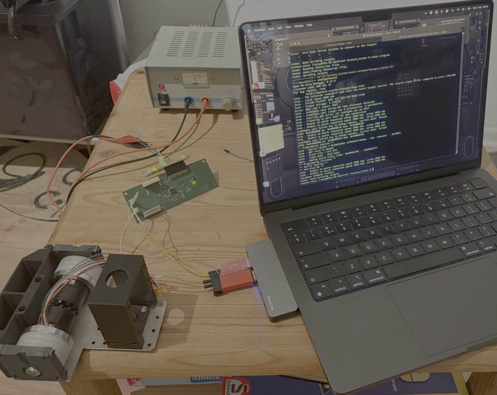
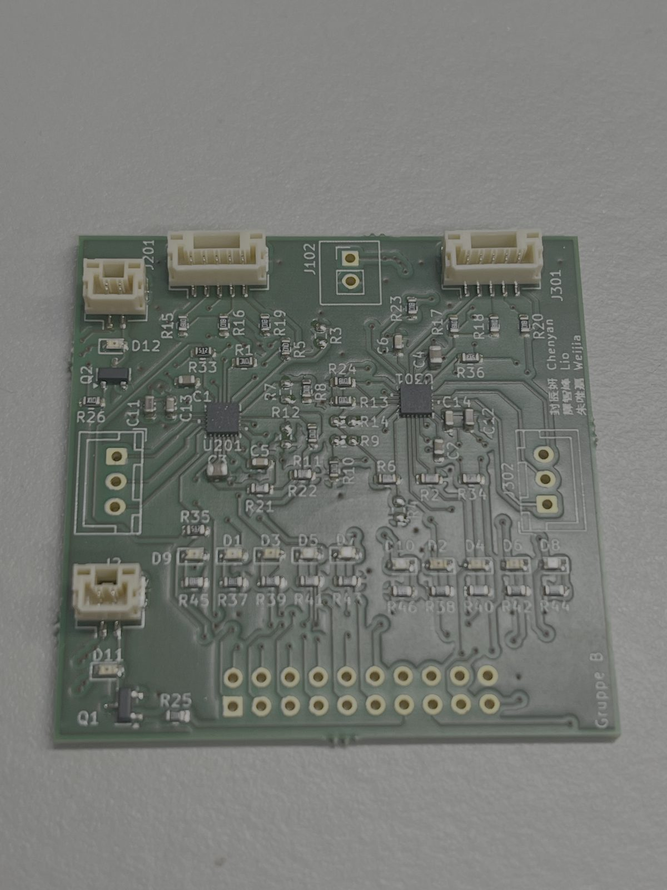
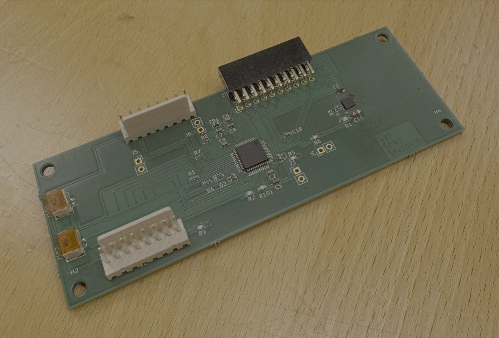
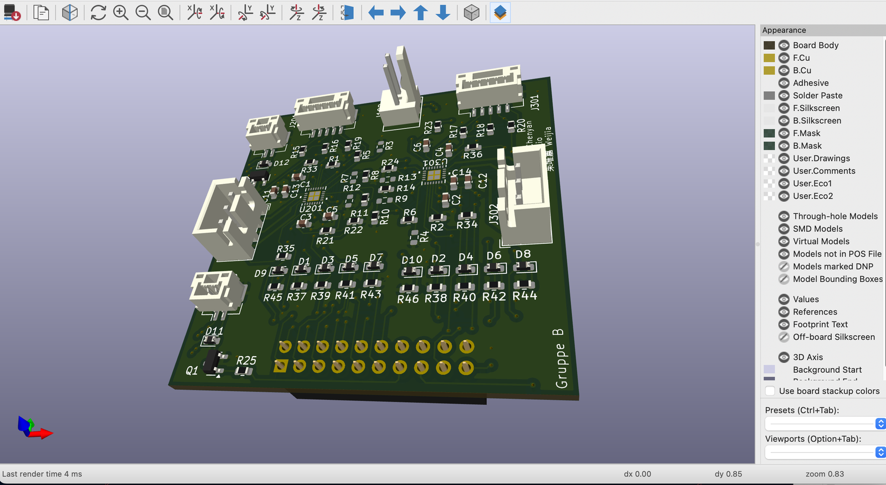
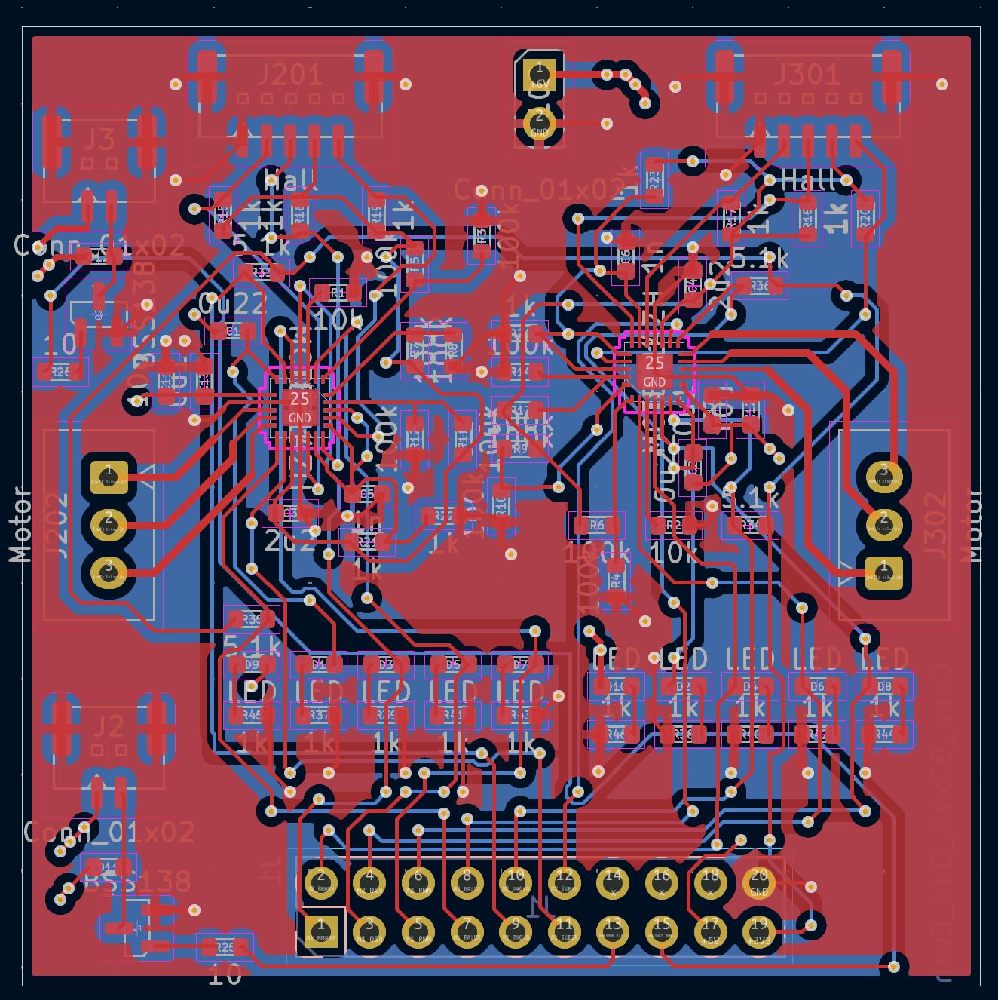
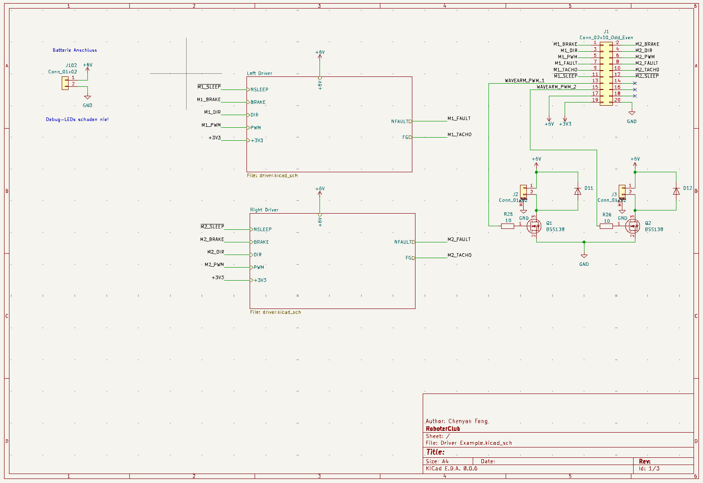
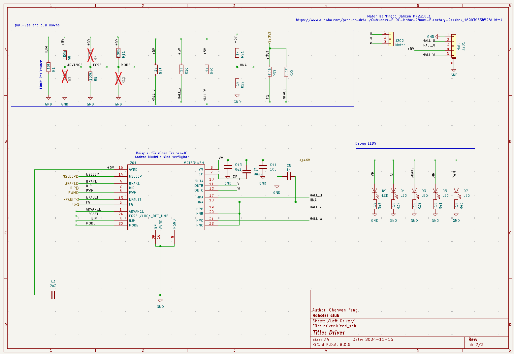

# SIMA Robot: BLDC Motor-Driver Board & STM32 Bring-up Firmware

Hardware design and bring-up firmware for a small two-wheeled mobile robot, built by a student team (Group B) at the [Roboter Club Aachen](https://roboterclub.rwth-aachen.de/), RWTH Aachen University, in 2024–25. The robot was built as a SIMA for the [Eurobot](https://www.eurobot.org/) competition: one of the small autonomous robots a team fields alongside its main robot.



## What's in this repository

| Folder | Contents |
|---|---|
| [`pcb_design/Driver/`](pcb_design/Driver) | KiCad 8 project, 4-layer **motor-driver board**: two TI MCT8314Z Hall-sensor BLDC motor drivers, status LEDs on each driver's VM, CP, BRAKE, DIR and PWM signals, two low-side MOSFET outputs (BSS138) for auxiliary actuators, and a 2×10 board-to-board connector |
| [`pcb_design/MCU/`](pcb_design/MCU) | KiCad 8 project, 4-layer **controller board**: STM32G474CET6 (Arm Cortex-M4F, 170 MHz), 3.3 V LDO and a connector for a VL53L0X time-of-flight distance sensor |
| [`firmware/led_blink_test/`](firmware/led_blink_test) | First bring-up: system clock, UART logging and an LED heartbeat running in a modm fiber (lightweight thread) |
| [`firmware/motor_driver_test/`](firmware/motor_driver_test) | Motor-driver bring-up: 10 kHz PWM on TIM3/TIM2, then cycles both drivers through run, reverse, brake and sleep modes while logging over UART |

Each board folder also has an interactive bill of materials (`bom/ibom.html`, opens in any browser). The driver board's part numbers and prices are listed in `pcb_design/Driver/Driver_BOM.csv`.

## My role

<!-- TODO(Lio): check each bullet and edit it so that it describes exactly what you did. -->
- Co-designed the **motor-driver board** in KiCad with two teammates. The controller board was designed by other members of Group B.
- Hand-assembled the boards, including SMD soldering, and replaced faulty components during bring-up.
- Wrote the **bring-up firmware** in C++ with [modm](https://modm.io): clock tree (170 MHz PLL), GPIO and timer/PWM configuration for both motor channels, and the driver-mode tests.
- Debugged signal problems with a logic analyser and UART logs.

## Hardware overview

```
6 V battery ──▶ Driver board ── 2 × MCT8314Z ──▶ 2 × BLDC motors (Hall sensors, planetary gearbox)
                    ▲    │
 BRAKE, DIR, PWM,   │    │  nFAULT, FG (tacho),
 nSLEEP per motor,  │    │  +6 V supply
 +3.3 V             │    ▼        (2×10 board-to-board connector)
                Controller board ── STM32G474 + 3.3 V LDO ── UART logging, I²C (VL53L0X)
```

## Building and flashing the firmware

**Requirements:** `arm-none-eabi-gcc`, [SCons](https://scons.org), OpenOCD and an ST-LINK programmer.

```bash
cd firmware/motor_driver_test   # or firmware/led_blink_test
scons build                     # compile
scons program                   # flash via OpenOCD + ST-LINK (see openocd.cfg)
```

The modm library generated for each project is committed in its `modm/` folder, so no extra setup is needed to build. To regenerate it, check out modm at `firmware/modm` (the path set in `project.xml`) and run `lbuild build` in the project folder.

## Gallery

| | |
|---|---|
|  |  |
| Assembled motor-driver board | Controller board with STM32G474 (designed by teammates) |
|  |  |
| KiCad 3D view of the driver board | Driver board layout |
|  |  |
| Top-level schematic: two driver channels, board-to-board connector and MOSFET outputs | One driver channel: MCT8314Z with Hall inputs, configuration resistors and status LEDs |

## Status and limitations

- This repository contains **bring-up and test firmware only**. Hardware bring-up and debugging took up the time available, so the team did not get to implement the autonomous driving logic before the deadline.
- The drivers' fault (nFAULT) and tacho (FG) lines are routed to the MCU but not yet read in firmware.
- The I²C set-up for the VL53L0X sensor is prepared but commented out.

## Datasheets

- [STM32G474CE](https://www.st.com/en/microcontrollers-microprocessors/stm32g474ce.html) (the datasheet and the RM0440 reference manual are under *Documentation*)
- [TI MCT8314Z](https://www.ti.com/product/MCT8314Z)
- [ST VL53L0X](https://www.st.com/en/imaging-and-photonics-solutions/vl53l0x.html)

## Credits

- Team: Group B, Roboter Club Aachen. <!-- TODO(Lio): add teammates' names here if they agree. -->
- The driver schematic started from the Roboter Club Aachen driver-IC example template.
- `firmware/led_blink_test/main.cpp` is based on a Roboter Club Aachen example by Raphael Lehmann (MPL-2.0; the licence header is kept).
- [modm](https://modm.io) is licensed under MPL-2.0.
